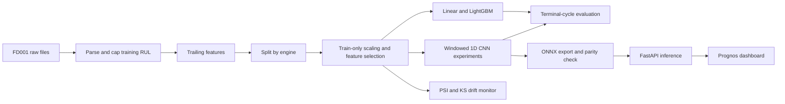

# Prognos

[](.github/workflows/ci.yml)

Prognos is a research prototype for examining turbofan run-to-failure data and estimating remaining cycles from recent sensor windows. It uses NASA's simulated C-MAPSS data, beginning with FD001; it is not a spacecraft propulsion model. The console has separate Overview, Engine Registry, RUL Comparison, Model Evaluation, and Data Quality views. Search, sorting, engine detail, report export, and local ONNX scoring use the real evaluation report and model artifacts. Until a real benchmark run completes, values remain clearly marked as pending.

## Dataset setup

This repository does not download or redistribute the data. Download **“6. Turbofan Engine Degradation Simulation Data Set”** from NASA’s [PCoE repository](https://www.nasa.gov/intelligent-systems-division/discovery-and-systems-health/pcoe/pcoe-data-set-repository/) using its [NASA-hosted ZIP archive](https://phm-datasets.s3.amazonaws.com/NASA/6.+Turbofan+Engine+Degradation+Simulation+Data+Set.zip). Extract the three FD001 files from the archive’s `CMaps/` directory into `Prognos/data/raw/` (the `Prognos` project root), so these exact paths exist:

```text
data/raw/train_FD001.txt
data/raw/test_FD001.txt
data/raw/RUL_FD001.txt
```

Files must be headerless, whitespace-separated and match the published 26-column C-MAPSS format. The test RUL file contains one terminal-cycle label per test engine. Missing files cause a direct error; synthetic results are never substituted for benchmark results.

## Quick start

Requires Python 3.12. Install dependencies and run checks with `make setup`, `make lint`, and `make test`. Once the files above are present, run `make train`. Start the product console and API with `make serve`, then open `http://localhost:8000`. The dashboard reads readiness and evaluation artifacts from `/api/dashboard`; `/health`, `/model-info`, and `/predict` are also exposed. After training, use **Score Engine** to select a local C-MAPSS cycle file and run a prediction on an engine's latest window. The browser sends only that window to the local API. `make docker` builds and starts the dashboard even when no model is present; inference becomes available after training creates a valid model bundle.

The current machine has no FD001 raw files and no trained model artifact. Therefore all real-data metrics, model ranking, measured inference latency, ONNX parity on trained weights, and benchmark plots are **pending**; no performance numbers are claimed.

## Manual hosting

The API and dashboard are packaged as a non-root Docker image. To check the deployment build locally, run `make docker`; Docker Compose publishes port `8000` by default and exposes `/health` as its health check. To choose another port, set `PORT` before starting Compose, for example `PORT=8080 docker compose up --build`. The container honors the hosting platform's `PORT` environment variable and binds to `0.0.0.0`. The lightweight serving image installs only inference dependencies; training and test dependencies remain in `pyproject.toml`.

For a hosted inference deployment, first run the real FD001 training pipeline. It writes the ONNX model and its preprocessing bundle to `models/`; these files are copied into the image at build time. The `.pt` training checkpoint is excluded from the Docker build. The ONNX file is intentionally not ignored by Git so it can be included in a deployment commit if that is your chosen artifact workflow. A host can also set `PROGNOS_MODEL` to the absolute path of a mounted ONNX artifact. Do not deploy with a missing model expecting predictions: the dashboard will load, while `/health` reports `model_missing` and `/predict` returns 503.

No hosting provider has been configured or contacted. The dashboard is currently hostable as a research interface, but usable inference requires the missing benchmark data, a completed training run, and its generated model bundle. Keep the dataset files out of the image and repository; `.dockerignore` excludes `data/raw/` from image builds.

## Architecture



## Results

| Model | FD001 test RMSE | NASA score | p50 / p95 latency |
|---|---:|---:|---:|
| Linear regression | Pending raw data | Pending | Pending model |
| LightGBM | Pending raw data | Pending | Pending model |
| 1D CNN | Pending raw data | Pending | Pending model |

These fields are intentionally blank of invented measurements. Run `make train` and `python scripts/benchmark.py` after dataset and model setup.

## Limitations

FD001 is simulated turbofan data representing a single operating condition and fault mode. It is an aerospace maintenance research prototype, not a spacecraft propulsion model. A successful benchmark does not establish field reliability, maintenance readiness, certification, or generalization to a real fleet. Agency deployment would require representative propulsion-system telemetry, hazard and assurance work, operator workflows, and domain validation. FD002–FD004 are not implemented as tested datasets yet. Drift is a univariate sensor distribution check, not a diagnosis or automatic retraining policy.
